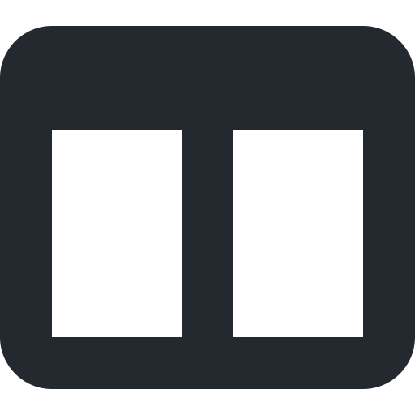
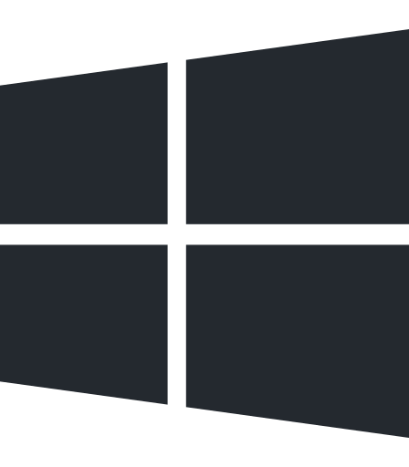

&nbsp;

# chesco

C++, Windows internals, UI.

I write native tools and the pieces around them.

 

&nbsp;&nbsp;&nbsp;

&nbsp;&nbsp;&nbsp;

&nbsp;&nbsp;&nbsp;

  

**C++** &nbsp;·&nbsp; **Win32** &nbsp;·&nbsp; **ui/ux** &nbsp;·&nbsp; Discord `0x050`

 

